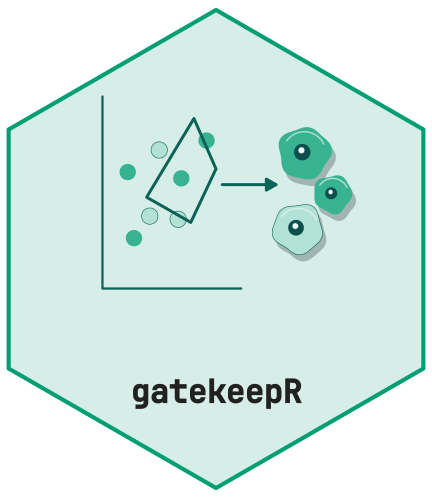
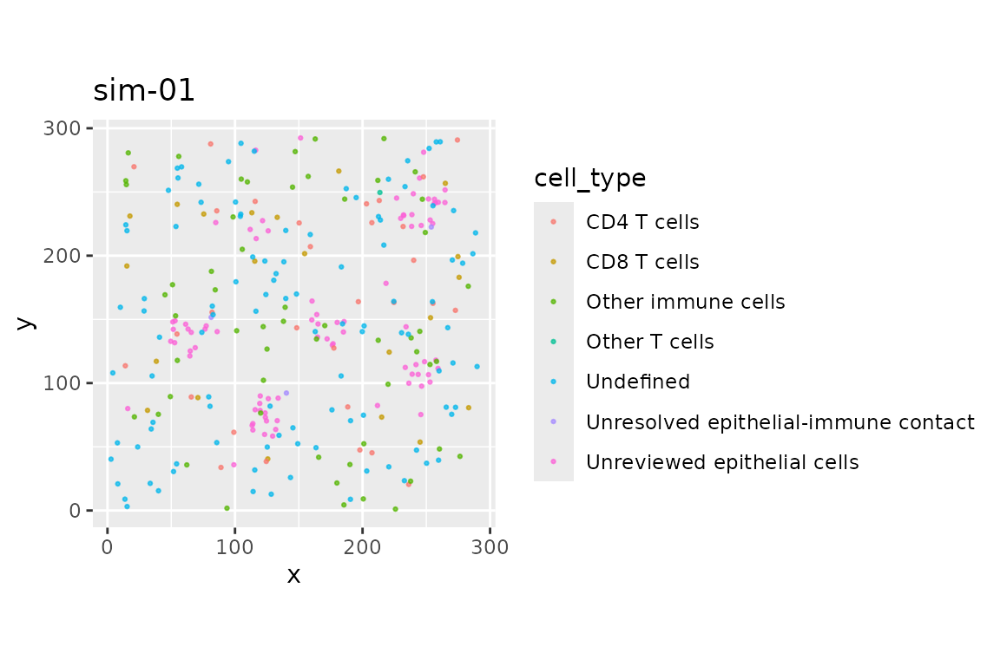
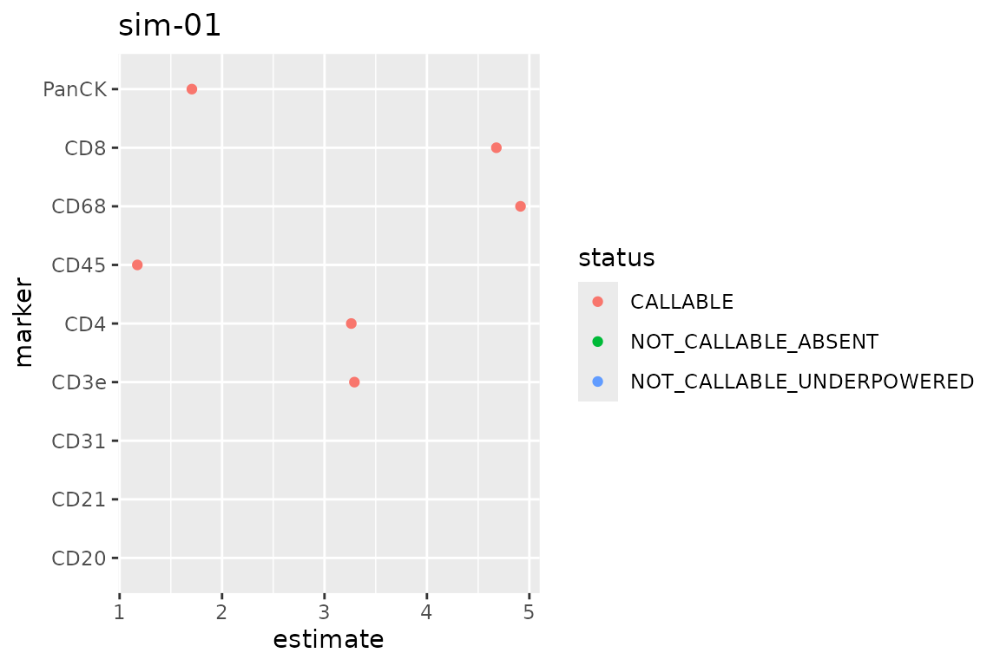
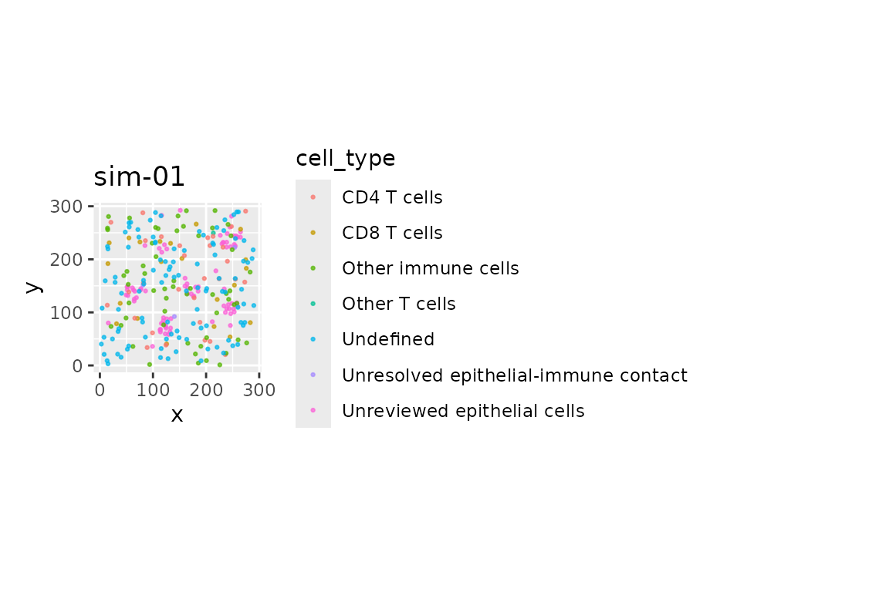

# gatekeepR: a reviewable marker gating workflow



`gatekeepR` turns per-cell marker measurements into reviewable phenotype
and state calls. The same prepared objects and classifier are used by
batch code, the review application, and the locked export. This keeps a
reviewed result replayable after the interactive session has ended.

## The complete workflow

The following code is the smallest end-to-end template. It uses a
configuration and a panel declared as data, then carries the result
through correction, thresholding, classification, state calls,
structures, review, and export.

``` r

cfg <- gk_example_config()
cells <- gk_simulate(n_cells = 300L, seed = 7L)
prep <- gk_prepare(cells, config = cfg, quiet = TRUE)
corrected <- gk_correct(prep, method = "robust_z")
thresholds <- gk_thresholds(prep, cfg, correction = corrected, seed = 7L)
classification <- gk_classify(prep, thresholds, config = cfg, correction = corrected)
#> Warning: 4 hierarchy rules disabled because required markers are not
#> callable.
states <- gk_state_calls(prep, thresholds, classification, config = cfg)
structures <- gk_structures(classification, prep)
review <- gk_review(classification, states, structures, thresholds, prep)
reviewed <- gk_replay(review)

snapshot <- gk_lock(review, reviewer = "example-reviewer", status = "PENDING")
export_dir <- tempfile("gatekeepR-example-")
gk_export(snapshot, dir = export_dir)
stopifnot(all(gk_verify_export(export_dir,
  expected_review_id = snapshot$review_id_full)$ok))
```

PENDING is deliberate: running an example does not complete scientific
review. Warnings about disabled rules identify unsupported channels in
the simulated panel and are retained as evidence in the export.

[`gk_replay()`](../reference/gk_replay.md) is the review boundary: it
applies the append-only ledgers to the initial calls and returns the
effective reviewed state.
[`gk_save_review()`](../reference/gk_save_review.md) and
[`gk_load_review()`](../reference/gk_load_review.md) persist the review
package before export when work must be resumed later.

## Outputs and auditability

The `classification`, `states`, and `structures` objects retain the cell
and image identifiers needed to join results back to source data. A
locked export contains the effective calls, review ledgers,
configuration, provenance, and a manifest.
[`gk_verify_export()`](../reference/gk_verify_export.md) checks the
manifest and replays the exported decisions, so downstream code can
reject incomplete or contradictory exports.

## Optional interfaces

Plots are thin views over the same objects used by batch code:

``` r

image_id <- prep$cells$image_id[[1L]]
gk_plot_map(reviewed, image_id = image_id)
```



``` r

gk_plot_thresholds(thresholds, image_id = image_id)
```



``` r

gk_plot_overview(reviewed, image_id = image_id)
```



The review app can load a review or an exported result with
`shiny::runApp(gk_app(review = review))` or
`shiny::runApp(gk_app(export = export_dir))`. The app does not create a
separate classification implementation.
