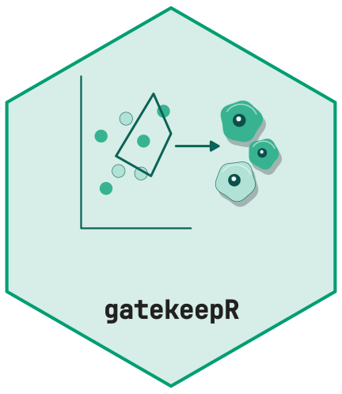
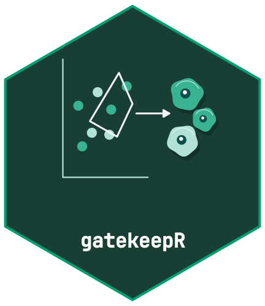

<!-- cttir-vignette-logo: start -->

  
  

<!-- cttir-vignette-logo: end -->

`gatekeepR` separates measurement preparation, correction, threshold
estimation, classification, review, and export. This separation makes each
decision inspectable, but it does not replace biological validation of a panel
or threshold choice.

Threshold methods can be sensitive to support, outliers, density shape, and
embedding settings. A returned status and callability flag must be carried into
downstream analysis. Small or ambiguous structures remain reviewable rather
than being silently promoted to a phenotype.

The package uses simulated examples in its tests and vignettes. Project users
should add independent positive and negative controls and record the assay,
image-processing, and panel versions in their own provenance layer.
